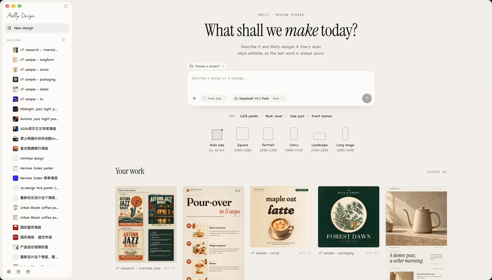
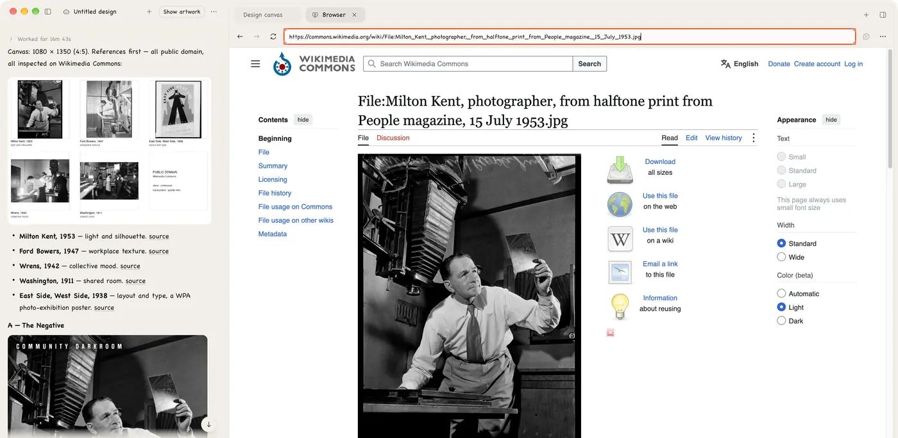
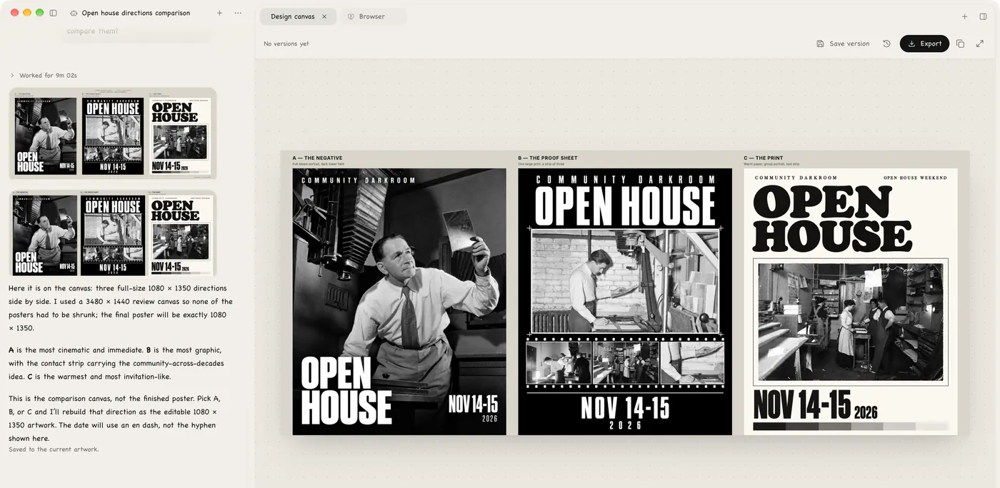
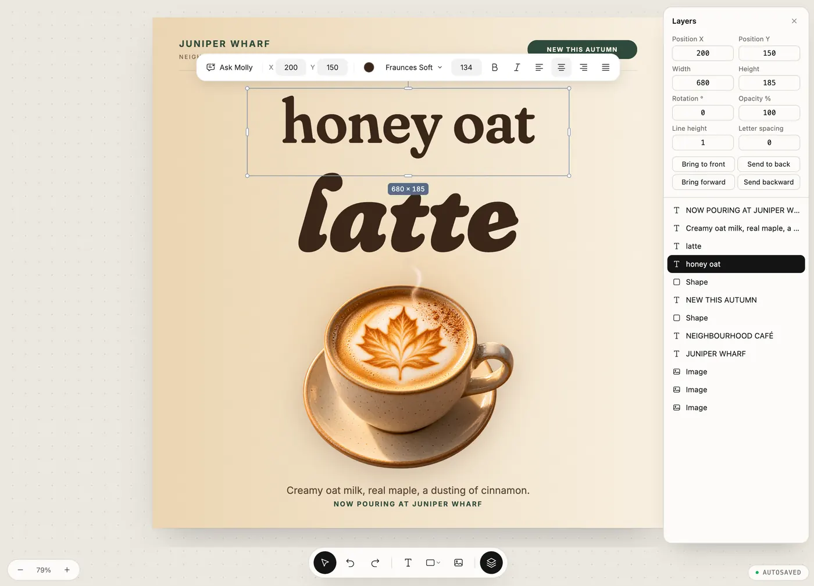
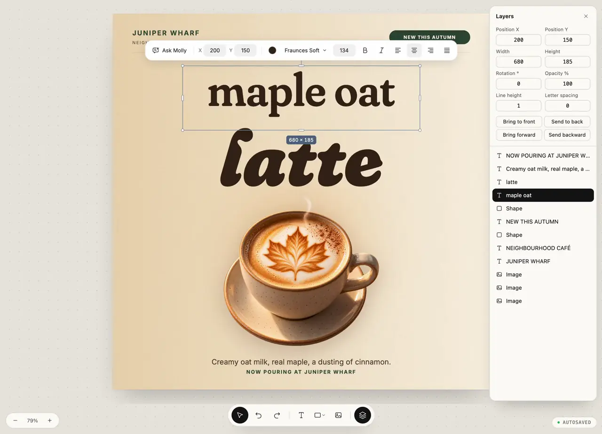
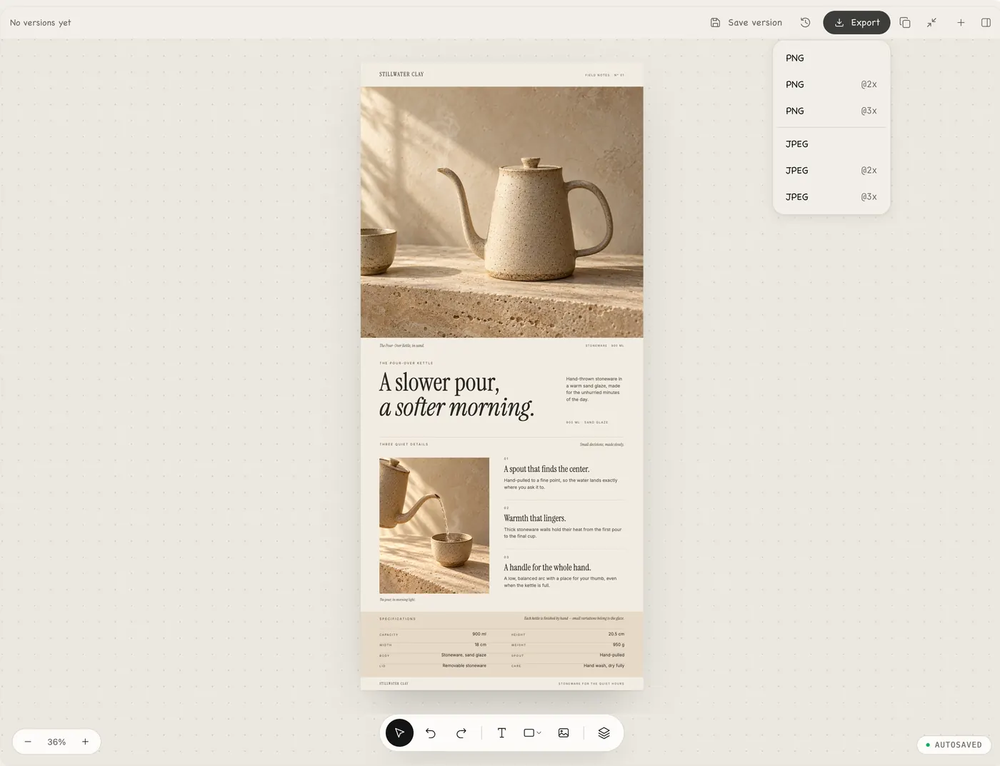
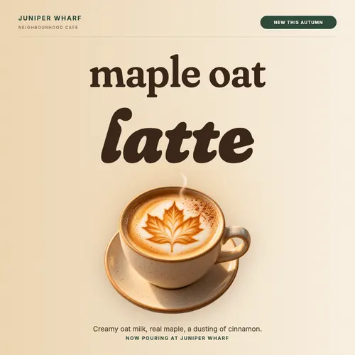
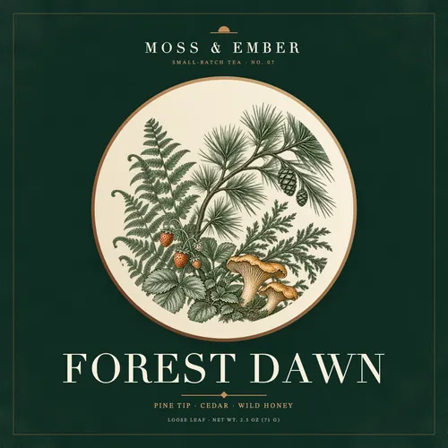
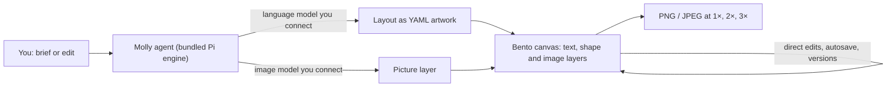

<picture>
  <source media="(prefers-color-scheme: dark)" srcset="website/assets/brand/molly-wordmark.svg">
  
</picture>

**AI design for graphic designers. Every layer stays editable.**

Describe a poster, a social post or a product page. Molly's agent builds it on a real canvas as text, shape and image layers, so you can change a word or move a block without starting over.

[](https://github.com/LeonEthan/molly-design/releases/latest)

[](LICENSE)

[Website](https://molly-design.pages.dev) · [Download](https://github.com/LeonEthan/molly-design/releases/latest) · [User guide](USER_GUIDE.md) · [Report a bug](https://github.com/LeonEthan/molly-design/issues/new?template=01-bug-report.yml) · [简体中文](README.zh-CN.md)



---

## Contents

- [What is Molly](#what-is-molly)
- [How a job goes](#how-a-job-goes)
- [Features](#features)
- [Made in Molly](#made-in-molly)
- [How it works](#how-it-works)
- [Models you can connect](#models-you-can-connect)
- [Quick start](#quick-start)
- [FAQ](#faq)
- [Roadmap](#roadmap)
- [Run from source](#run-from-source)
- [Project structure](#project-structure)
- [Contributing](#contributing)
- [Help and community](#help-and-community)
- [Security](#security)
- [License and credits](#license-and-credits)

## What is Molly

Molly is a desktop app for graphic design with an AI agent. You brief it the way you would brief a colleague. It looks for references, offers a few directions, and builds the one you pick as an editable file.

Most AI image tools hand back one flat picture, and changing a single word means generating it again. In Molly, headlines and small print are real text layers, rules and marks are vector shapes, and the image model only makes the picture layer. Ask for changes in the conversation, or select a layer and edit it yourself. Then export PNG or JPEG.

Everything runs on your computer. Artwork, versions and conversations are stored locally. You connect your own models and keys, and there is no Molly account.

## How a job goes

**1. Write the brief.** Pick a size (square, portrait, story, landscape, long image, or let the agent decide) and say in a sentence or two what it is, who it is for and how it should feel.

**2. Find references.** When the job calls for it, the agent opens Molly's built-in browser, looks for references and notes what it took from each one.



**3. Pick a direction.** The agent lays out a few directions side by side on the canvas with a note on each, then waits for you to choose.



**4. Revise on the same file.** For a small change, select the text and retype it. For a bigger one, ask in chat. Before each agent edit, Molly keeps a version you can go back to.



[](website/assets/video/edit-v7c.mp4)

*Click the frame to watch the 9-second recording (MP4).*

**5. Export.** Save, then export PNG or JPEG at 1×, 2× or 3×. The client gets the image; the editable file and its versions stay with you for the next round.



## Features

- **Real layers.** Text, shapes and images are separate layers in the Bento editor. Nothing important is baked into a picture.
- **Edit by hand or by chat.** Use the selection toolbar and the Layers panel, or describe the change and let the agent edit the same design.
- **Precise controls.** Type exact position, size, rotation, opacity, line height and letter spacing; reorder layers by name.
- **Explores first.** The agent can research references in a built-in browser and propose several directions before committing to one.
- **Versions.** Manual edits autosave. Save versions yourself, and Molly keeps a "Before Molly's edit" version before each agent turn on existing artwork.
- **Size presets.** Social and screen formats, plus print sheets (A4, A5, A3, US Letter, business card) as pixel sizes.
- **Export.** PNG or JPEG at 1×, 2× or 3×.
- **Your models, your keys.** Pick the connection, model and thinking level per session. Keys are stored encrypted on your computer.
- **Local by default.** Artwork, versions and conversations are local files. Requests go directly to the providers you configure.
- **Extensible.** Add MCP servers under Settings → Advanced and choose which ones a turn may use.
- **Website accounts.** Optionally import sign-in cookies from Chrome, Edge, Brave, Arc, Vivaldi, Opera or Chromium so the agent's browser can reach design and commerce sites you already use.

## Made in Molly

Exported from Molly as is. The brands and events are made up.

| Key visual | Social post | Packaging label |
| --- | --- | --- |
|  |  |  |

Also: a [product detail page](website/assets/img/s-detail-900.webp) and a [long-form brew guide](website/assets/img/s-longform-900.webp), both 1080 × 2400, where every headline, spec and step is a text layer.

Good fits today: event posters and key visuals, social posts, e-commerce product detail pages and long images, labels, and simple print pieces sized in pixels.

## How it works



- The desktop app bundles its own agent engine, Pi (the `@earendil-works/pi-*` packages); you do not install a separate agent CLI.
- The agent writes the design as a YAML projection of a BentoDoc file. Bento renders it as editable layers, and your manual edits are written back to the same files.
- While the agent is working, the canvas is read-only so its draft and your edits do not overwrite each other.
- The language model plans and writes the layout. The image model only generates or edits the picture layers.

*TODO(verify): add a link to the Pi engine's upstream repository once the team confirms which one to credit.*

## Models you can connect

First launch asks you to connect **both** a language model and an image model. Molly does not resell model access; each provider bills you directly.

**Language models** (Settings → AI models → Models)

| Provider | Sign-in |
| --- | --- |
| OpenAI | Sign in with ChatGPT, or API key |
| Kimi Code | Membership API key, or device-code sign-in |
| Anthropic, Google, xAI, DeepSeek, Moonshot, Z.ai, MiniMax, OpenRouter | API key |
| OpenAI-compatible (advanced) | Any Chat Completions endpoint, with model discovery. Local Ollama and LM Studio work without a key. |

**Image models** (Settings → AI models → Image generation)

| Service type | Notes |
| --- | --- |
| OpenAI Images-compatible API | Enter the API root, key and exact model. Molly checks the key against the free `/models` list. |
| DashScope | Never checked automatically, because every DashScope request is billed. |

Which models you can actually use depends on the provider and your key. The presets ship in the app, but only some combinations have been tested end to end; see [release status and support limits](USER_GUIDE.md#release-status-and-support-limits).

## Quick start

1. **Install.** Download the signed and notarized DMG from the [latest release](https://github.com/LeonEthan/molly-design/releases/latest), open it and drag **Molly.app** into Applications. On first launch, choose **Always Allow** when macOS asks about the "Molly Safe Storage" keychain entry; it protects your saved keys.
2. **Connect models.** Molly asks for a language model and an image model before your first design. You can change them later in Settings → AI models.
3. **Make something.** Create a canvas and try:

   > Create an 800 × 600 workshop poster. Use a dark blue background, a large "Make something" heading, and the subtitle "Saturday · 14:00". Keep the text editable.

   Then ask "Make the heading smaller and give the subtitle more space", or click the heading and edit it yourself. Export when you are done.

More in the [user guide](USER_GUIDE.md): [connections](USER_GUIDE.md#configure-connections), [saving and recovery](USER_GUIDE.md#continue-preview-and-recover), [troubleshooting](USER_GUIDE.md#troubleshooting), [backup and uninstall](USER_GUIDE.md#back-up-uninstall-and-recover-data).

## FAQ

**Do I need a Molly account?**
No. There is no Molly cloud account. You only sign in to the model providers you choose.

**Where is my data?**
On your computer. Artwork, versions and conversations are local files; keys are kept in encrypted local storage. The [user guide](USER_GUIDE.md#back-up-uninstall-and-recover-data) lists the exact folders and how to back them up.

**Does it cost anything?**
Molly is free and open source. Model and image usage is billed by the providers you connect.

**Which models should I use?**
Any language model and image model from the lists above. Molly does not pick for you; each session uses the connection and model you select, and fails clearly instead of silently switching.

**Can I use it without an image model?**
Not at the moment. First launch requires both a language model and an image model.

**Does it work offline?**
Your files open and edit offline. Generating or revising with the agent needs a model: a cloud provider needs internet, while a local OpenAI-compatible service such as Ollama or LM Studio can run on your own network for the language model. The image model also has to be reachable.

**How is this different from asking a chat AI for a poster?**
A chat tool usually returns one flat image. Molly gives you a layered file you can align, reword and roll back, and keeps it locally for the next round.

**Can I make print files?**
Sizes are in pixels, including A-series and US Letter presets. There is no bleed or millimetre unit yet, so screen and social work fit best.

**Which platforms are supported?**
The public release is for macOS on Apple Silicon. Windows and Intel Mac builds exist in the codebase but are experimental and not supported yet. Linux desktop support is retired.

**How do I update?**
On macOS, Molly checks for new releases in the app and can update itself (Sparkle). You can also download the latest DMG from [Releases](https://github.com/LeonEthan/molly-design/releases/latest) at any time.

## Roadmap

Current focus, shipped versions and locked product decisions are tracked in the pinned [Release map (#44)](https://github.com/LeonEthan/molly-design/issues/44). Feature ideas are welcome as [feature requests](https://github.com/LeonEthan/molly-design/issues/new?template=02-feature-request.yml). We do not publish dates for unreleased work.

## Run from source

Requirements: Node.js `>=22.19.0 <23 || >=23.6.0`, Git, npm, the repository-pinned pnpm via Corepack, and native build tools (Xcode Command Line Tools on macOS).

```sh
git clone https://github.com/LeonEthan/molly-design.git
cd molly-design
git submodule update --init packages/acp-extension-core packages/acp-extension-dsh
corepack pnpm install
corepack pnpm start:local
```

The first build also assembles the Bento editor in a temporary checkout and may need network access. Quit any running Molly first; only one instance can run. To keep development data separate, set `MOLLY_DATA_DIR="$(pwd)/.molly-dev-data"`. The open-source build needs no `.env` file, account or cloud variables.

For daily testing on Apple Silicon macOS, run `pnpm preview:install`. It builds through
the release packaging pipeline and installs **Molly Preview.app** in `~/Applications`,
ready to open from Finder. Preview has separate settings, data and background services,
can run alongside Molly, and never uses the release updater. Quit Preview before
rebuilding; reinstalling preserves its test data. See [local Preview](apps/electron/README.md#local-preview).

Before a pull request, run `pnpm check`, `pnpm format` and `pnpm run docs check`. Details are in [CONTRIBUTING.md](CONTRIBUTING.md).

## Project structure

| Path | What it holds |
| --- | --- |
| `apps/electron` | Desktop app, native integration and packaging |
| `apps/cli` | Embedded local service, agent execution and design persistence |
| `packages/components` | Shared workspace interface |
| `packages/design-bento` | Pinned Bento editor, Molly adaptations and rendering resources |
| `packages/design-authoring` | Lossless YAML artwork conversion and agent skills |
| `packages/harness-pi` | Bundled model engine and reviewed extensions |
| `packages/platform`, `packages/shared` | Platform ports and shared contracts |
| `packages/acp-extension-core`, `packages/acp-extension-dsh` | Required upstream protocol and capability contracts (submodules) |
| `e2e` | Desktop acceptance tooling |
| `website` | Official website source |

Other submodules under `vendor/` keep upstream and historical material outside the default build. See [source dependencies](CONTRIBUTING.md#source-dependencies) before touching them.

## Contributing

Bug reports, docs fixes, tests and focused pull requests are welcome, in English or Chinese.

- Start with an issue: [bug report](https://github.com/LeonEthan/molly-design/issues/new?template=01-bug-report.yml) or [feature request](https://github.com/LeonEthan/molly-design/issues/new?template=02-feature-request.yml).
- Community pull requests should stay under 1,000 changed lines; for anything larger, open an issue with your analysis first.
- Use [Conventional Commits](https://www.conventionalcommits.org/) and the pull request template.

Read [CONTRIBUTING.md](CONTRIBUTING.md) for the full terms and process. Contributions are accepted under Apache-2.0.

## Help and community

- Usage, recovery and known limits: [user guide](USER_GUIDE.md)
- Bugs and proposals: [GitHub Issues](https://github.com/LeonEthan/molly-design/issues)
- Product site: [molly-design.pages.dev](https://molly-design.pages.dev)

*TODO(verify): add a community channel (Discord, WeChat group, X account) here if the team has one.*

## Security

Please do not report vulnerabilities in a public issue. Use [private vulnerability reporting](https://github.com/LeonEthan/molly-design/security/advisories/new) instead, and leave real keys and personal data out of reports. See [SECURITY.md](SECURITY.md).

## License and credits

Molly is released under the [Apache License 2.0](LICENSE).

Molly is an independent project based on [Lody](https://github.com/LodyAI/Lody); Lody's original authorship and Apache-2.0 license are retained. The [Bento](https://github.com/nyblnet/bento) editor is vendored under the MIT License. Other components keep their own licenses. See [NOTICE](NOTICE) and [THIRD_PARTY_NOTICES.md](THIRD_PARTY_NOTICES.md).

### Acknowledgments

Thanks to the [Lody](https://github.com/LodyAI/Lody) team for the desktop and agent-execution foundation, to [Bento](https://github.com/nyblnet/bento) for the editor and renderer, to the Pi engine authors, and to [models.dev](https://models.dev) for the model catalog Molly uses to fill in model details.
