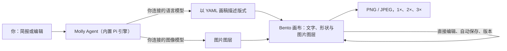

<picture>
  <source media="(prefers-color-scheme: dark)" srcset="website/assets/brand/molly-wordmark.svg">
  
</picture>

**面向平面设计师的 AI 设计。每一层都可编辑。**

描述一张海报、一条社交帖或一个商品页。Molly 的 Agent 会在真实画布上把它建成文字、形状与图片图层，改一个字、挪一块版式都不用从头再来。

[](https://github.com/LeonEthan/molly-design/releases/latest)

[](LICENSE)

[网站](https://molly-design.pages.dev) · [下载](https://github.com/LeonEthan/molly-design/releases/latest) · [用户指南](USER_GUIDE.zh-CN.md) · [报告问题](https://github.com/LeonEthan/molly-design/issues/new?template=01-bug-report.yml) · [English](README.md)


---

## 目录

- [Molly 是什么](#molly-是什么)
- [一项设计怎么进行](#一项设计怎么进行)
- [功能](#功能)
- [Molly 作品示例](#molly-作品示例)
- [工作原理](#工作原理)
- [可连接的模型](#可连接的模型)
- [快速开始](#快速开始)
- [常见问题](#常见问题)
- [路线图](#路线图)
- [从源码运行](#从源码运行)
- [项目结构](#项目结构)
- [参与贡献](#参与贡献)
- [帮助与社区](#帮助与社区)
- [安全](#安全)
- [许可证与致谢](#许可证与致谢)

## Molly 是什么

Molly 是一款带 AI Agent 的平面设计桌面应用。你可以像跟同事交代任务一样写简报。它会找参考、给出几个方向，并把选定方向做成可编辑文件。

多数 AI 出图工具只给你一张扁平图，改一个字往往要整张重生成。在 Molly 里，标题与正文是真实文字图层，线条与标记是矢量形状，图像模型只负责图片图层。在对话里提出修改，或选中图层自己改，然后导出 PNG 或 JPEG。

一切都在你的电脑上运行。作品、版本与会话保存在本地。你自行连接模型与密钥，无需 Molly 账户。

## 一项设计怎么进行

**1. 写简报。** 选尺寸（方形、竖版、Story、横版、长图，或交给 Agent 决定），用一两句话说明是什么、给谁看、要什么感觉。

**2. 找参考。** 需要时，Agent 会打开 Molly 内置浏览器查找参考，并记下从每条参考里借鉴了什么。


**3. 选方向。** Agent 在画布上并排摆出几个方向，每个附简短说明，然后等你选择。


**4. 在同一文件上修改。** 小改动：选中文字直接改。大改动：在对话里说明。每次 Agent 编辑前，Molly 会保留可回退的版本。


[](website/assets/video/edit-v7c.mp4)

*点击静帧观看约 9 秒录屏（MP4）。*

**5. 导出。** 保存后，以 1×、2× 或 3× 导出 PNG 或 JPEG。客户拿到的是图片；可编辑文件与版本留在你这边，方便下一轮修改。


## 功能

- **真实图层。** 在 Bento 编辑器中，文字、形状与图片是独立图层，重要内容不会烙进一张图里。
- **手工或对话编辑。** 用选择工具栏与图层面板，或在对话里描述修改，由 Agent 编辑同一设计。
- **精确控制。** 可输入精确的位置、尺寸、旋转、不透明度、行高与字距；按名称调整图层顺序。
- **先探索再定稿。** Agent 可在内置浏览器中调研参考，在敲定一个方向前提出多种方案。
- **版本。** 手工编辑自动保存；也可自行保存版本。在已有作品上，每次 Agent 回合前 Molly 会保留「Molly 编辑前」版本。
- **尺寸预设。** 社交与屏幕格式，以及以像素表示的印刷幅面（A4、A5、A3、US Letter、名片）。
- **导出。** 1×、2× 或 3× 的 PNG 或 JPEG。
- **你的模型、你的密钥。** 每个会话选择连接、模型与思考级别。密钥加密保存在你的电脑上。
- **默认本地。** 作品、版本与会话是本地文件；请求直接发往你配置的服务商。
- **可扩展。** 在「设置 → 高级」添加 MCP 服务器，并选择本回合允许使用哪些。
- **网站账户。** 可选从 Chrome、Edge、Brave、Arc、Vivaldi、Opera 或 Chromium 导入登录 Cookie，让 Agent 浏览器访问你已在使用的设计与电商站点。

## Molly 作品示例

自 Molly 直接导出，未再后期。品牌与活动均为虚构。

| 主视觉 | 社交帖 | 包装标签 |
| --- | --- | --- |
|  |  |  |

另有 [商品详情页](website/assets/img/s-detail-900.webp) 与 [长文冲泡指南](website/assets/img/s-longform-900.webp)，均为 1080 × 2400，标题、规格与步骤均为文字图层。

当前较适合：活动海报与主视觉、社交帖、电商详情页与长图、标签，以及以像素定尺寸的简单印刷品。

## 工作原理



- 桌面应用内置 Agent 引擎 Pi（`@earendil-works/pi-*` 包）；无需单独安装 Agent CLI。
- Agent 将设计写成 BentoDoc 的 YAML 投影。Bento 将其渲染为可编辑图层，你的手工修改会写回同一批文件。
- Agent 工作期间画布为只读，避免其草稿与你的编辑互相覆盖。
- 语言模型负责规划与编写版式；图像模型只生成或编辑图片图层。

*TODO(verify)：待团队确认应致谢的上游仓库后，在此补充 Pi 引擎链接。*

## 可连接的模型

首次启动会要求连接**语言模型与图像模型**。Molly 不转售模型访问；各服务商直接向你的账户计费。

**语言模型**（设置 → AI 模型 → 模型）

| Provider | 登录方式 |
| --- | --- |
| OpenAI | 使用 ChatGPT 登录，或 API key |
| Kimi Code | 会员 API key，或设备码登录 |
| Anthropic、Google、xAI、DeepSeek、Moonshot、Z.ai、MiniMax、OpenRouter | API key |
| OpenAI-compatible（高级） | 任意 Chat Completions 端点，支持模型发现。本地 Ollama 与 LM Studio 可无密钥使用。 |

**图像模型**（设置 → AI 模型 → 图像生成）

| 服务类型 | 说明 |
| --- | --- |
| OpenAI Images-compatible API | 填写 API 根地址、密钥与精确模型名。Molly 会用免费的 `/models` 列表校验密钥。 |
| DashScope | 不会自动校验，因为 DashScope 的每次请求都会计费。 |

实际可用模型取决于服务商与你的密钥。预设随应用提供，但并非所有组合都经过端到端测试；见[发布状态与支持限制](USER_GUIDE.zh-CN.md#发布状态与支持限制)。

## 快速开始

1. **安装。** 从[最新发布](https://github.com/LeonEthan/molly-design/releases/latest)下载已签名并公证的 DMG，打开后将 **Molly.app** 拖入「应用程序」。首次启动时，若系统询问「Molly Safe Storage」钥匙串条目，请选择**始终允许**；它用于保护已保存的密钥。
2. **连接模型。** 首次设计前，Molly 会要求配置语言模型与图像模型。之后可在「设置 → AI 模型」中更改。
3. **做一张试试。** 创建画布并输入例如：

   > Create an 800 × 600 workshop poster. Use a dark blue background, a large "Make something" heading, and the subtitle "Saturday · 14:00". Keep the text editable.

   然后可问「把标题缩小、给副标题更多空间」，或点击标题自行编辑。完成后导出。

更多内容见[用户指南](USER_GUIDE.zh-CN.md)：[配置连接](USER_GUIDE.zh-CN.md#配置连接)、[保存与恢复](USER_GUIDE.zh-CN.md#持续创作预览与恢复)、[故障说明](USER_GUIDE.zh-CN.md#故障说明)、[备份与卸载](USER_GUIDE.zh-CN.md#备份卸载与数据恢复)。

## 常见问题

**需要 Molly 账户吗？**
不需要。没有 Molly 云账户；你只需登录所选模型服务商。

**数据在哪里？**
在你的电脑上。作品、版本与会话是本地文件；密钥保存在加密本地存储中。[用户指南](USER_GUIDE.zh-CN.md#备份卸载与数据恢复)列出具体目录与备份方法。

**要花钱吗？**
Molly 免费且开源。模型与图像使用费由你连接的服务商收取。

**该用哪些模型？**
可使用上文列表中的任意语言模型与图像模型。Molly 不会替你选择；每个会话使用你选定的连接与模型，出错时会明确提示，不会静默切换。

**可以不配置图像模型吗？**
目前不行。首次启动需要同时配置语言模型与图像模型。

**能离线用吗？**
文件可离线打开与编辑。用 Agent 生成或修改需要模型：云服务商需要网络；语言模型也可使用本机网络上的 OpenAI 兼容服务（如 Ollama 或 LM Studio）。图像模型同样必须可达。

**和让聊天 AI 做海报有什么不同？**
聊天工具通常只返回一张扁平图。Molly 提供可对齐、改字、回滚的分层文件，并本地保存以便下一轮修改。

**能做印刷文件吗？**
尺寸以像素为单位，含 A 系与 US Letter 预设。尚无出血或毫米单位，屏幕与社交场景最合适。

**支持哪些平台？**
公开发布面向 Apple Silicon 上的 macOS。代码库中有 Windows 与 Intel Mac 构建，仍为实验性且暂不提供支持。Linux 桌面支持已退役。

**如何更新？**
在 macOS 上，Molly 可在应用内检查新版本并自行更新（Sparkle）。也可随时从 [Releases](https://github.com/LeonEthan/molly-design/releases/latest) 下载最新 DMG。

## 路线图

当前重点、已发布版本与已定产品决策见置顶 [Release map (#44)](https://github.com/LeonEthan/molly-design/issues/44)。功能想法欢迎通过[功能请求](https://github.com/LeonEthan/molly-design/issues/new?template=02-feature-request.yml)提出。未发布工作不公布日期。

## 从源码运行

要求：Node.js `>=22.19.0 <23 || >=23.6.0`、Git、npm、通过 Corepack 使用仓库固定的 pnpm，以及原生构建工具（macOS 上为 Xcode Command Line Tools）。

```sh
git clone https://github.com/LeonEthan/molly-design.git
cd molly-design
git submodule update --init packages/acp-extension-core packages/acp-extension-dsh
corepack pnpm install
corepack pnpm start:local
```

首次构建还会在临时 checkout 中组装 Bento 编辑器，可能需要网络。请先退出正在运行的 Molly；只能运行一个实例。若要与开发数据隔离，可设置 `MOLLY_DATA_DIR="$(pwd)/.molly-dev-data"`。开源构建无需 `.env`、账户或云环境变量。

提交拉取请求前请运行 `pnpm check`、`pnpm format` 与 `pnpm run docs check`。细节见 [CONTRIBUTING.md](CONTRIBUTING.md)。

## 项目结构

| Path | 内容 |
| --- | --- |
| `apps/electron` | 桌面应用、原生集成与打包 |
| `apps/cli` | 内嵌本地服务、Agent 执行与设计持久化 |
| `packages/components` | 共享工作台界面 |
| `packages/design-bento` | 固定版本 Bento 编辑器、Molly 适配与渲染资源 |
| `packages/design-authoring` | 无损 YAML 画稿转换与 Agent 技能 |
| `packages/harness-pi` | 内置模型引擎与已审核扩展 |
| `packages/platform`、`packages/shared` | 平台接口与共享合同 |
| `packages/acp-extension-core`、`packages/acp-extension-dsh` | 必需的上游协议与能力合同（子模块） |
| `e2e` | 桌面验收工具 |
| `website` | 官网源码 |

`vendor/` 下其他子模块保留默认构建之外的上游与历史材料。修改前请阅读[源码依赖](CONTRIBUTING.md#source-dependencies)。

## 参与贡献

欢迎英文或中文的缺陷报告、文档修正、测试与聚焦的拉取请求。

- 请先开 Issue：[缺陷报告](https://github.com/LeonEthan/molly-design/issues/new?template=01-bug-report.yml)或[功能请求](https://github.com/LeonEthan/molly-design/issues/new?template=02-feature-request.yml)。
- 社区拉取请求请控制在 1,000 行变更以内；更大改动请先开 Issue 说明分析。
- 使用 [Conventional Commits](https://www.conventionalcommits.org/) 与拉取请求模板。

完整条款与流程见 [CONTRIBUTING.md](CONTRIBUTING.md)。贡献按 Apache-2.0 接受。

## 帮助与社区

- 使用、恢复与已知限制：[用户指南](USER_GUIDE.zh-CN.md)
- 缺陷与建议：[GitHub Issues](https://github.com/LeonEthan/molly-design/issues)
- 产品站：[molly-design.pages.dev](https://molly-design.pages.dev)

*TODO(verify)：若团队已有社区渠道（Discord、微信群、X 账号），在此补充。*

## 安全

请勿在公开 Issue 中报告漏洞。请使用[私密漏洞报告](https://github.com/LeonEthan/molly-design/security/advisories/new)，报告中勿包含真实密钥或个人数据。见 [SECURITY.md](SECURITY.md)。

## 许可证与致谢

Molly 以 [Apache License 2.0](LICENSE) 发布。

Molly 是基于 [Lody](https://github.com/LodyAI/Lody) 的独立项目；保留 Lody 原作者与 Apache-2.0 许可证。[Bento](https://github.com/nyblnet/bento) 编辑器按 MIT 许可证 vendored。其他组件保留各自许可证。见 [NOTICE](NOTICE) 与 [THIRD_PARTY_NOTICES.md](THIRD_PARTY_NOTICES.md)。

### 致谢

感谢 [Lody](https://github.com/LodyAI/Lody) 团队在桌面与 Agent 执行方面的基础工作，感谢 [Bento](https://github.com/nyblnet/bento) 的编辑器与渲染器，感谢 Pi 引擎作者，以及 [models.dev](https://models.dev) 提供的模型目录（Molly 用它补全模型信息）。
